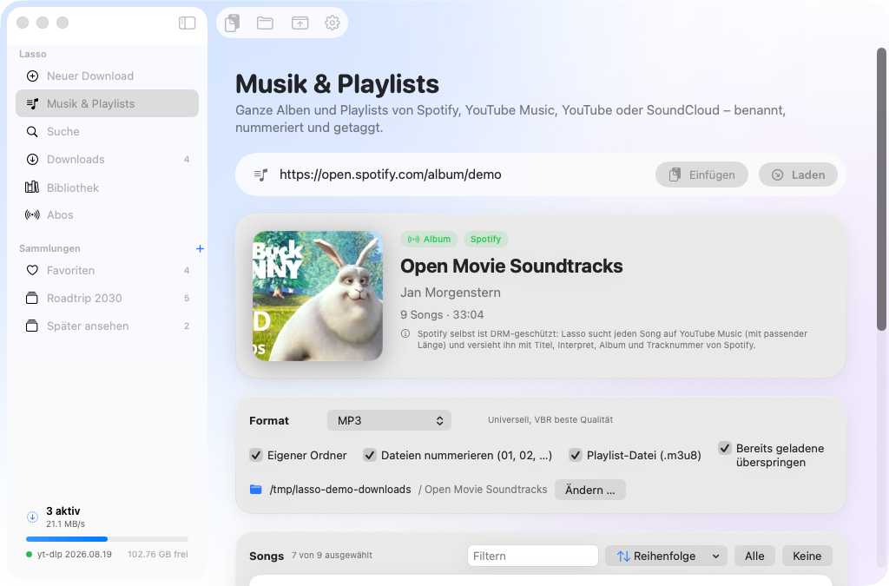
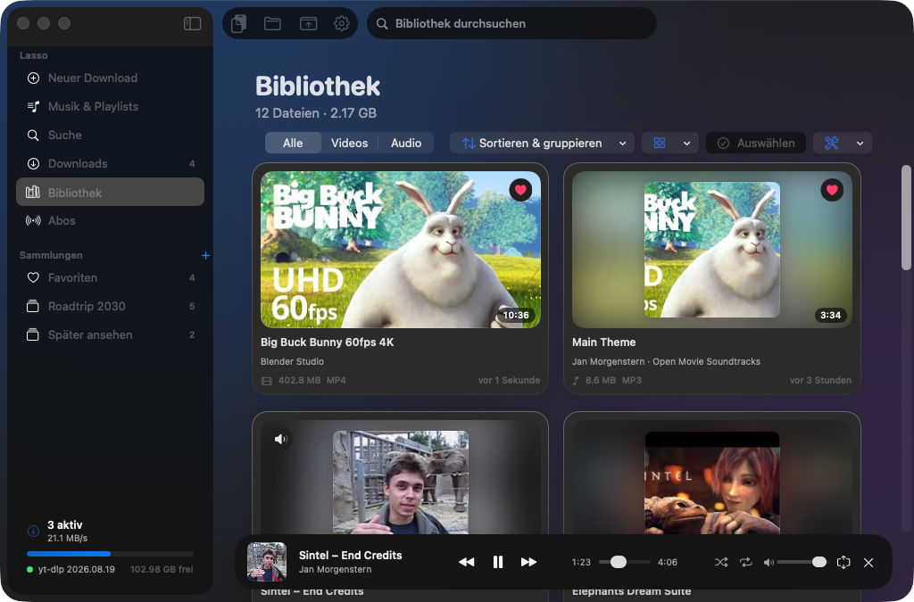
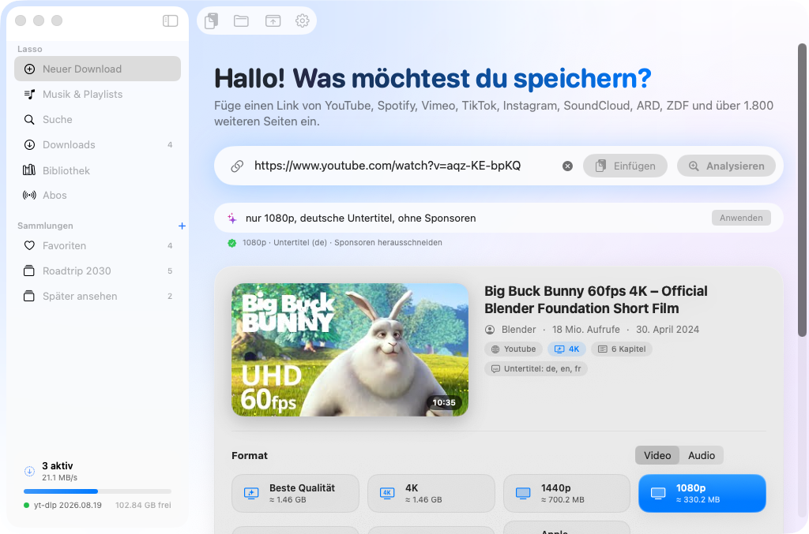
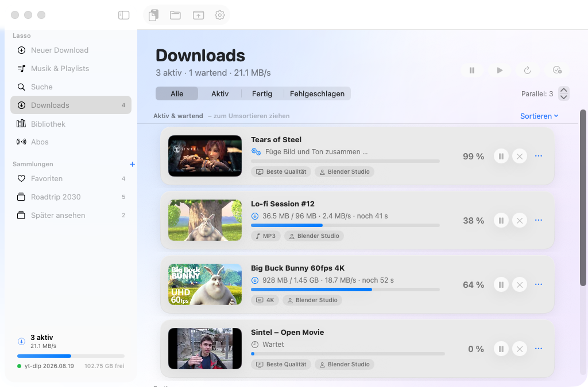
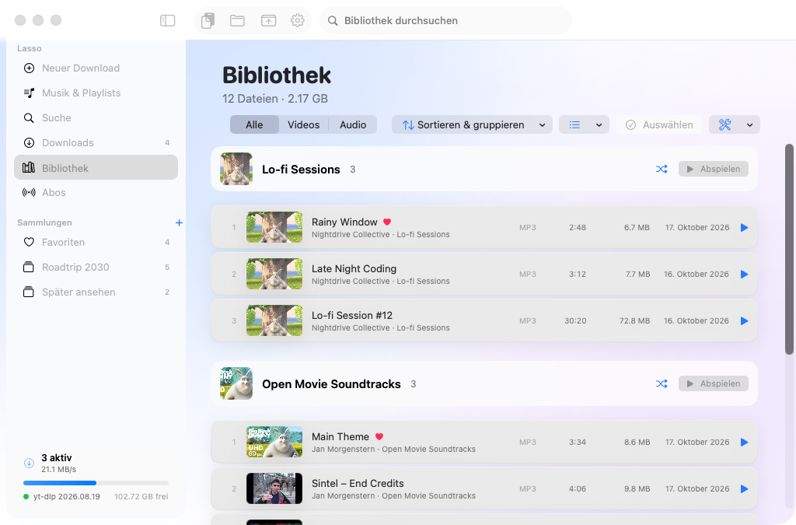
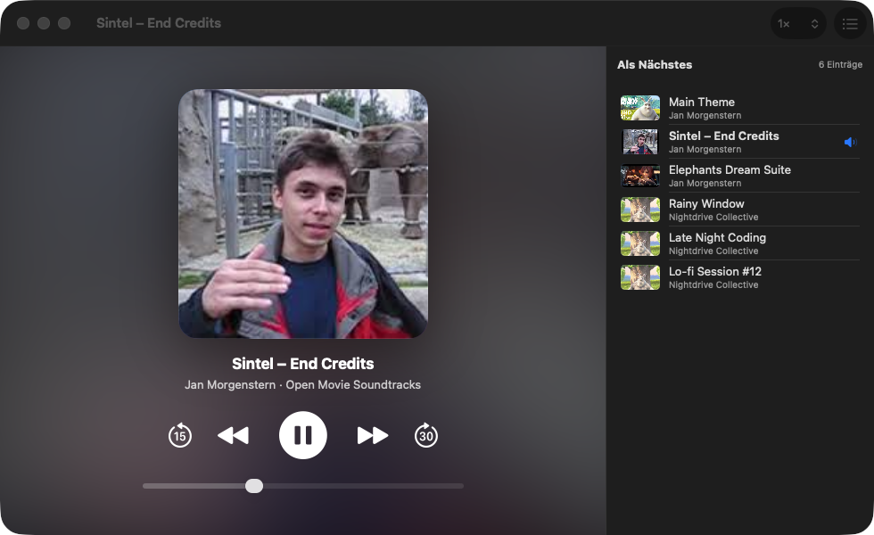

# Lasso 1.0 – the successor of MacYTDL 2030

**[⬇︎ Lasso.dmg herunterladen](https://github.com/kmitulla/MacYTDL/releases/latest/download/Lasso.dmg)** · macOS 14 Sonoma or later · Apple Silicon & Intel

Lasso is a native SwiftUI app with a Liquid Glass design for macOS 26/27, built on MacYTDL. The source is in [`Lasso/`](Lasso).
Settings, library and subscriptions from MacYTDL 2030 are taken over automatically.

* **Music & Spotify**: paste Spotify songs, albums, playlists or an artist. Spotify itself is DRM-protected, so Lasso reads the song list, finds every song on YouTube Music (checking the length) and writes Spotify's title, artists, album, track number, year and a square cover into the MP3/M4A/FLAC/Opus file. An optional free Spotify API key loads playlists longer than 100 songs.
* **Playlists** from YouTube, YouTube Music, SoundCloud and more: preview, pick songs, reorder by drag & drop or sort by album/artist/length/shuffle, own folder, numbered files, `.m3u8` playlist file, and “skip already downloaded” to sync a playlist later.
* **Built-in player**: mini player, player window with Up Next, Picture in Picture, full screen, shuffle/repeat, speed, media keys/Control Center, resumes long videos where you stopped. Formats macOS can't play are converted with one click.
* **Organize the library**: favorites, collections with their own order, group by album/artist/website/month, sort by album & track, plays, length …, edit tags (also inside the files), sort files into folders (Artist/Album/Title …), find duplicates, import folders, export `.m3u8`, convert to MP4/M4A/MP3.
* **Menu bar mode**: the yellow window button (or ⌥⌘M) hides Lasso in the menu bar; the ring icon shows live progress and has a mini player.
* **Customize the look**: Liquid Glass, frosted or solid surfaces, accent colors, background glow, compact layout, thumbnails on/off, hide sidebar pages.
* Everything from MacYTDL 2030: preview with qualities and sizes, smart commands (“nur Audio als MP3 von 1:20 bis 3:00 ohne Sponsoren”), parallel queue with pause/resume and retries, YouTube search, subscriptions, clips, SponsorBlock, subtitles, ⇧⌘V instant download, Services menu, bookmarklets and a `lasso://` URL scheme.
* Includes yt-dlp, FFmpeg and Deno, so no Homebrew and no admin password are needed. yt-dlp updates itself daily. German and English UI.

**Installing:** open the DMG and drag Lasso to Applications. The app is ad-hoc signed, not notarized, so the first time you open it go to System Settings › Privacy & Security and click “Open Anyway”, or run `xattr -dr com.apple.quarantine /Applications/Lasso.app`.

**Building:** `cd Lasso && ./scripts/fetch_tools.sh vendor && ./scripts/build_app.sh vendor && ./scripts/make_dmg.sh` (Xcode 26). CI (`.github/workflows/lasso-app.yml`) builds a universal app, runs real downloads, tagging, playlist and Spotify parsing tests through the app engine (`Lasso --selftest`), captures screenshots and publishes the DMG.

---

# MacYTDL

MacYTDL is a utility which downloads videos using the [_youtube-dl_](https://github.com/ytdl-org/youtube-dl) and [_YT-DLP_](https://github.com/yt-dlp/yt-dlp) video downloader scripts. _youtube-dl_ and _YT-DLP_ are able to download videos from a great many web sites. MacYTDL runs on any Apple Mac with macOS 10.10 or later. macOS 10.15 or higher is required to use _YT-DLP_. MacYTDL has been developed mostly in AppleScript. The code is not accessable from within the applet. However, text exports of the code are in the "Code" folder above and can be opened in _Script Editor_. MacYTDL is code signed and notarized.

[Download from here](https://github.com/section83/MacYTDL/releases/download/1.23.1/MacYTDL-v1.23.1.dmg).

#### Main dailog

### Features

* Download individual videos and playlists.
* Download multiple videos separately (in parallel) or in one process (sequentially).
* Works with all sites supported by [_youtube-dl_](https://github.com/ytdl-org/youtube-dl) and [_YT-DLP_](https://github.com/yt-dlp/yt-dlp).
* Can switch between _youtube-dl_ and _YT-DLP_ on Macs running macOS from 10.15 to 12.2.1.
* Can cancel individual downloads.
* Can pause/resume downloads.
* By default, will resume interrupted downloads if passed the URL.
* Can pass through any custom settings to _youtube-dl_ and _YT-DLP_.
* Settings for level of youtube-dl feedback, download folder, file format, remuxing format, download speed, proxy URL, Quicktime compatibility, custom file name template etc.
* Batch downloads.
* Download a text description of the video.
* Localisation – currently Spanish, Italian, French and German are available (switching languages is supported in macOS 10.15 and later).
  * Localisation is not yet up-to-date.
* Download and embed subtitles in chosen format and language including auto-generated captions from YouTube.
* Download and optionally embed thumbnail images and metadata.
* Download or extract audio-only files in chosen format.
* Optional macOS Service which gets the current text selection, clipboard contents or active web browser URL, switches to MacYTDL and pastes URL of video to be downloaded.
* The Service can be set to automatically download from the URL of the current web page without showing the Main dialog.
* Settings can be saved, restored and rest to default.
* All components downloaded and/or installed by MacYTDL, which can be controlled by the user. Component updates available in the app.
* Issues notification (via [*Alerter*](https://github.com/vjeantet/alerter)) when download finished with option to play the video.
* A separate log file is retained for each download enabling problem solving if a download fails.
* Has a built-in uninstaller which moves all components to Trash.
* Includes a range of simple utilities.
* Uses arm64 or x86_64 code according to user's Mac.

### Requirements

An Apple Mac running macOS 10.10 Yosemite and higher is required to use MacYTDL. MacYTDL works in Parallels virtual machines.

_youtube-dl_ can be used with all versions of macOS up to Monterey 12.2.1 and is the default for Macs running macOS versions prior to 10.15 Catalina.

_YT-DLP_ is the default for Macs running macOS 10.15 Catalina or higher. Python 3.8 is built into the _YT-DLP_ executable. Macs running macOS 10.14 or 10.13 can use _YT-DLP_ if two libaries are installed. Some detail on the two library files is on page 51 of the [Help](https://github.com/section83/MacYTDL/blob/master/Images/Help.pdf).

### How to install for the first time

* Download and open [the DMG file](https://github.com/section83/MacYTDL/releases/download/1.23.1/MacYTDL-v1.23.1.dmg).
* Browse the Help file.
* Click and drag MacYTDL to any location - it's best to use the Applications folder.
* Open MacYTDL.
* Click on "Yes" to install various components and create a preferences folder when asked.
* Provide administrator credentials when asked.
* Wait.
* MacYTDL main dialog is displayed.

### How to update

* Download and open [the DMG file](https://github.com/section83/MacYTDL/releases/download/1.23.1/MacYTDL-v1.23.1.dmg).
* Click and drag MacYTDL to your usual location – make sure to replace the old version.
* Open MacYTDL. Components such as the preferences file are updated as required.
  * Users on macOS 10.15 Catalina and higher are invited to install _YT-DLP_.

More detail is available in [the Help file](https://github.com/section83/MacYTDL/blob/master/Images/Help.pdf) (3.97MB).

### Bugs, problems, questions
To report bugs, problems etc., get a Github account, click on the "Issues" tab above and open a new issue.  Alternatively, open an item in "Discussions" above or send an email to macytdl@gmail.com.

### Acknowledgements

MacYTDL would be useless without [youtube-dl](https://github.com/ytdl-org/youtube-dl) and [_YT-DLP_](https://github.com/yt-dlp/yt-dlp). They are remarkable, feature rich tools maintained by the most dedicated group of volunteers. It should be noted that [youtube-dl](https://github.com/ytdl-org/youtube-dl) has not been updated since December 2021. [_YT-DLP_](https://github.com/yt-dlp/yt-dlp), however, is in active development.

Much is owed to Shane Stanley, for his many contributions solving problems with MacYTDL. Shane developed [Dialog Toolkit Plus](https://latenightsw.com/support/freeware/) which provides the dialogs in MacYTDL. Ideas for this GUI front-end came from many sources including:

* Adam Albrec, author of PPC Media Centre.
* Michael Page (http://techion.com.au), author of the Video Hoarder automator script.
* “kopurando” (https://github.com/kopurando), author of the Virga downloader.
* “Tombs” (https://forum.videohelp.com/members/235982-Tombs) an active contributor to [Whirlpool](www.whirlpool.net.au) and author of the URLDown Dropper utility for Windows.
* “xplorr” (https://forum.videohelp.com/members/268051-xplorr), author of TVDownloader.
* Anonymous (https://cresstone.com/apps/youtubeDLFrontEnd/), author of youtubeDLFrontEnd.
* Frank, Geoff, John, Santo, Trevor and Walter, fellow members of the [ACT Apple Users Group](https://www.actapple.org.au).
* MacYTDL users 1alessandro1, 11lucasarr11, Adam, AirMarty, Alex, alphabitnz, Andy, andyrb412, artcore-c, barney1903, Başar, BigJoe309, bovirus, Brandon, CdrSpock, Dantha, darbid, defcon5at, Didier EuronymousDeadOhlin, frissonlabs, gustavosaez, Hamza, heviiguy, hunterbr3193, ItsMorePaul, Jack, janvdvelde, jeremydouglass, kuglee, L-Kiewa, Labhansh-Sharma. LeonardoMaracino, MalEbenSo, martinsstuff, meiwechner, michel-GH, Mike, MrJmpl3, Nellio, nottooloud, onaforeignshore, pedrocadiz13, Peter, QAQDE, Rick, Raymond-Adams, roest01, SwineBurglar, Ted, thejasonparker, tht7, tigrr, Tobias, Tom, TomasCarlson, upekshapriya, Vinsamlegast78, Woolfy025, zxzzz8.

### MacYTDL is free

MacYTDL is a retirement project for me and will always be free. Please consider sponsoring the [_YT-DLP_](https://github.com/yt-dlp/yt-dlp) team. Detail on sponsorships is available here: https://github.com/yt-dlp/yt-dlp/blob/master/Collaborators.md#collaborators.

If you use other shareware or open source software consider making a donation to the developers – let them know they are appreciated.
